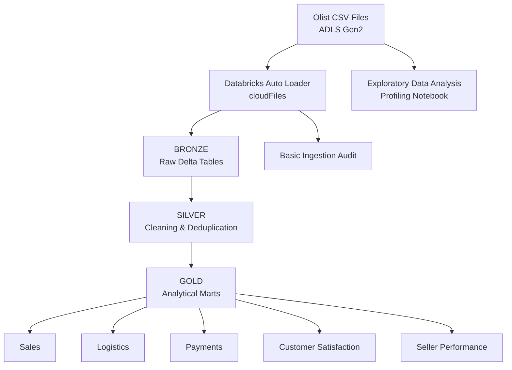

# Olist Data Pipeline

Pipeline de ingeniería de datos desarrollado con **Python, PySpark y Azure Databricks** para procesar el dataset de comercio electrónico Olist. El proyecto organiza el procesamiento mediante una arquitectura Medallion, desde la ingesta de archivos CSV hasta la generación de conjuntos de datos agregados para análisis.

## Descripción del proyecto

El proyecto implementa una canalización de datos organizada en tres capas:

- **Bronze:** ingesta de archivos CSV y persistencia en tablas Delta.
- **Silver:** limpieza técnica, conversión de tipos y deduplicación de registros.
- **Gold:** generación de cinco conjuntos de datos agregados para distintos dominios de negocio.

La solución trabaja con nueve datasets del proyecto Olist y utiliza Databricks Auto Loader para la ingesta de archivos desde Azure Data Lake Storage Gen2.

## Arquitectura



La arquitectura de ambientes y Unity Catalog conservada del README anterior es una **referencia de arquitectura objetivo**, no evidencia de funcionalidades desplegadas. Consulta [Estrategia de ambientes y arquitectura objetivo](docs/architecture/environment-strategy.md).

## Flujo de procesamiento

### 1. Bronze — Data Ingestion

La ingesta utiliza **Databricks Auto Loader** (`cloudFiles`) sobre Spark Structured Streaming. El código implementa:

- Configuración de nueve datasets Olist mediante metadata JSON.
- Lectura de archivos CSV desde una ruta configurada en ADLS Gen2.
- Procesamiento de archivos disponibles mediante el trigger `availableNow`.
- Checkpoints para mantener el estado del procesamiento.
- Escritura de datos en formato Delta.
- Incorporación de metadatos técnicos: `_ingestion_timestamp` y `_source_file`.
- Registro básico de ejecuciones en una tabla de auditoría.

Las tablas de origen se escriben con el prefijo `raw_`.

### 2. Silver — Data Transformation

Esta capa aplica transformaciones técnicas sobre los nueve datasets. Entre las operaciones implementadas se encuentran:

- Conversión de tipos de datos.
- Tratamiento de valores nulos seleccionados.
- Deduplicación de registros.
- Aplicación de reglas específicas por dataset.
- Persistencia de resultados en tablas Delta.

Los procesos actuales utilizan escritura en modo `overwrite`.

### 3. Gold — Analytical Data Marts

La capa Gold contiene cinco procesos de transformación basados en joins y agregaciones sobre las tablas Silver:

| Data mart | Enfoque |
|---|---|
| Sales | Análisis de ventas |
| Logistics | Análisis logístico |
| Payments | Análisis de pagos |
| Customer Satisfaction | Satisfacción del cliente |
| Seller Performance | Desempeño de vendedores |

Estos conjuntos de datos están orientados al análisis y consumo posterior.

## Exploración y profiling

El repositorio incluye un [notebook exploratorio](notebooks/exploration/Discover-EDA.ipynb) que permite analizar los nueve datasets de origen. Contiene operaciones de:

- Inferencia y revisión de esquemas.
- Conteo de registros.
- Consulta de muestras de datos.
- Identificación de duplicados exactos.
- Análisis de valores nulos por columna.

Este notebook constituye una herramienta exploratoria de profiling; no representa un sistema automatizado de validación de calidad de datos.

## Stack tecnológico

| Categoría | Tecnologías |
|---|---|
| Lenguaje | Python |
| Procesamiento distribuido | PySpark, Apache Spark |
| Ingesta | Databricks Auto Loader, Spark Structured Streaming |
| Almacenamiento de tablas | Delta Lake |
| Cloud Storage | Azure Data Lake Storage Gen2 |
| Plataforma | Azure Databricks |
| Configuración | JSON |
| Consultas y permisos | SQL |
| Control de versiones | Git, GitHub |
| Automatización de repositorio | GitHub Actions, Databricks CLI |

## Estructura del repositorio

```text
.
├── .github/workflows/
│   └── databricks_deploy.yml
├── config/
│   └── ingestion_metadata.json
├── dashboard/
│   └── dashboard.pbix
├── docs/architecture/
│   └── environment-strategy.md
├── notebooks/exploration/
│   └── Discover-EDA.ipynb
├── sql/
│   ├── DDL/01_create_control_table.sql
│   └── permissions.sql.dbquery.ipynb
└── src/
    ├── bronze/ingest_to_bronze.py
    ├── silver/
    │   ├── clean_orders.py
    │   ├── clean_products.py
    │   └── generic_rules_for_any_table.py
    └── gold/
        ├── mart_customer_satisfaction.py
        ├── mart_logistics_performance.py
        ├── mart_payment_behavior.py
        ├── mart_sales_performance.py
        └── mart_seller_performance.py
```

- `config/`: configuración y metadata de ingesta.
- `src/bronze/`: proceso de ingesta a Bronze.
- `src/silver/`: transformaciones de limpieza.
- `src/gold/`: generación de data marts.
- `.github/workflows/`: automatización de sincronización del repositorio.
- `notebooks/exploration/`: notebook de exploración y profiling.
- `sql/DDL/`: definición SQL de la tabla de auditoría.
- `sql/permissions.sql.dbquery.ipynb`: sentencias SQL de permisos.
- `dashboard/`: archivo `.pbix` en desarrollo; no es un dashboard finalizado.
- `docs/architecture/`: estrategia de ambientes preservada como referencia objetivo.

## Automatización con GitHub Actions

El repositorio incluye un workflow que se activa ante cambios en la rama `master` y utiliza Databricks CLI para sincronizar el repositorio con Databricks Repos.

Este mecanismo automatiza la sincronización del código fuente. No implementa actualmente pruebas automatizadas, promoción entre ambientes ni despliegue integral de la canalización de datos.

## Estado actual de la implementación

El proyecto cuenta con código para los siguientes componentes:

| Capacidad | Estado |
|---|---|
| Ingesta con Auto Loader | Implementada en código |
| Checkpoints y trigger `availableNow` | Implementados en código |
| Escritura Delta en Bronze | Implementada en código |
| Limpieza y deduplicación en Silver | Implementada en código |
| Cinco data marts en Gold | Implementados en código |
| Exploración y profiling | Implementados en notebook |
| Registro básico de auditoría | Implementado en código |
| Workflow de sincronización con Databricks | Implementado |

**Importante:** la existencia del código no constituye evidencia de una ejecución exitosa de extremo a extremo. La revisión disponible del proyecto fue estática y no verificó una ejecución integral en un entorno Databricks.

## Limitaciones y oportunidades de mejora

Las siguientes capacidades no están implementadas de manera integral o no están demostradas en el repositorio:

- CDC (Change Data Capture).
- SCD Type 2.
- Validaciones automatizadas de calidad de datos con reglas de aceptación.
- Cuarentena de registros inválidos.
- Observabilidad integral y monitoreo de la canalización.
- Aislamiento operativo completo de ambientes Dev, Test y Prod.
- CI/CD con pruebas y promoción entre ambientes.
- Modelo dimensional completo con dimensiones y tablas de hechos.
- Dashboard de Power BI terminado.

El archivo [`dashboard/dashboard.pbix`](dashboard/dashboard.pbix) se considera un artefacto en desarrollo, no un dashboard analítico finalizado.

También es necesario validar que la organización física de los archivos CSV en ADLS Gen2 coincida con las rutas que construye actualmente el proceso de ingesta antes de ejecutar la canalización.

## Próximas mejoras

El proyecto puede evolucionar mediante las siguientes etapas:

1. Validación y corrección de rutas de ingesta.
2. Incorporación de pruebas unitarias e integración.
3. Implementación de reglas automatizadas de calidad de datos.
4. Fortalecimiento de auditoría y observabilidad.
5. Procesamiento incremental y estrategias CDC/SCD.
6. Gobierno y aislamiento de ambientes con Unity Catalog.
7. Automatización de despliegues y validaciones.
8. Desarrollo del dashboard analítico en Power BI.

Estas mejoras representan una evolución propuesta y no funcionalidades disponibles actualmente.

## Objetivo de aprendizaje

Este proyecto permite aplicar conceptos fundamentales de ingeniería de datos mediante el uso de procesamiento distribuido, ingesta de archivos, almacenamiento Delta y transformación de datos en una arquitectura Medallion.

También sirve como base para evolucionar hacia una plataforma de datos con mejores prácticas de calidad, gobierno, observabilidad y automatización.
